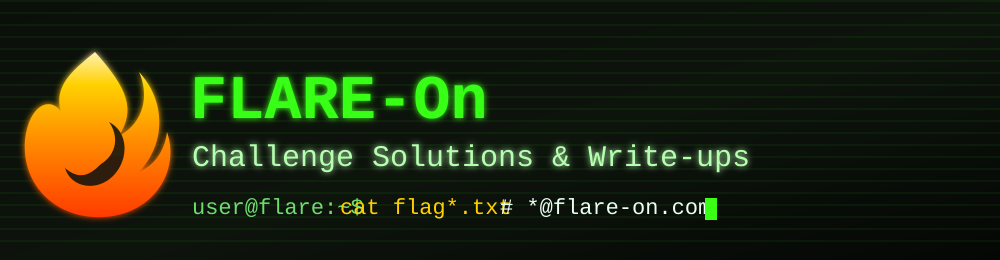

<div align="center">



# 🔥 FLARE-On Challenge Solutions

Solutions and detailed write-ups for the FLARE-On reverse-engineering CTF challenges I solved.


</div>

---

> **FLARE-On** was the Mandiant (FLARE) team's annual single-player Capture-the-Flag contest, a series of reverse-engineering puzzles that ran every fall. Every flag is an email address ending in `@flare-on.com`. Each folder here holds the original challenge artifacts, my solver scripts, analysis notes, and a full `WRITEUP.md`.

## 🧩 Challenges

<table>
  <thead>
    <tr><th>#</th><th>Challenge</th><th>Type</th><th>Key techniques</th><th>Write-up</th></tr>
  </thead>
  <tbody>
    <tr>
      <td align="center"><br><b>1</b></td>
      <td><a href="./1-flarecaptcha">FlareCaptcha</a></td>
      <td>Web / JavaScript</td>
      <td>Source review · double-layer XOR · known-plaintext recovery</td>
      <td><a href="./1-flarecaptcha/WRITEUP.md">📄</a></td>
    </tr>
    <tr>
      <td align="center"><br><b>2</b></td>
      <td><a href="./2-GhostStream">GhostStream</a></td>
      <td>Windows RE</td>
      <td>NTFS alternate data stream · embedded PE · named pipe · modified RC4 + XOR</td>
      <td><a href="./2-GhostStream/WRITEUP.md">📄</a></td>
    </tr>
    <tr>
      <td align="center"><br><b>3</b></td>
      <td><a href="./3-flareon13_doc">flareon13_doc</a></td>
      <td>Polyglot / Forensics</td>
      <td>PDF/ZIP/VHD/UDF polyglot · EBCDIC · JBIG2 · self-modifying DOS stub · RC4 key from XORed hashes</td>
      <td><a href="./3-flareon13_doc/WRITEUP.md">📄</a></td>
    </tr>
    <tr>
      <td align="center"><br><b>4</b></td>
      <td><a href="./4-ToxicMiner">ToxicMiner</a></td>
      <td>Windows RE</td>
      <td>Custom SHA-256 compression · RC4 · emulated serial derivation</td>
      <td><a href="./4-ToxicMiner/README.md">📄</a></td>
    </tr>
    <tr>
      <td align="center"><br><b>5</b></td>
      <td><a href="./5-catthief">catthief</a></td>
      <td>Network forensics / Rust RE</td>
      <td>PCAP carving · RC4 · canonical Huffman decompression</td>
      <td><a href="./5-catthief/WRITEUP.md">📄</a></td>
    </tr>
  </tbody>
</table>

## 🚩 Flags

<details>
<summary><b>Spoiler warning</b> — click to reveal the flags</summary>

<br>

| # | Challenge | Flag |
|:-:|-----------|------|
| 1 | FlareCaptcha | `triskaidekaphobia@flare-on.com` |
| 2 | GhostStream | `y0u_kn0w_n07h1n6_j0n_5n0w@flare-on.com` |
| 3 | flareon13_doc | `Ju$7_4_l177l3_7r34$ur3_HUN7@flare-on.com` |
| 4 | ToxicMiner | `cpu_m3lt3d_4nd_all_i_g0t_w4s_th1s_fl4g@flare-on.com` |
| 5 | catthief | `th3r3_b3_tr34sure_1n_th4t_pc4p@flare-on.com` |

The write-ups contain full spoilers too. To solve the challenges yourself, start from the artifacts in each folder and skip the `WRITEUP.md` files.

</details>

## 📂 Repository layout

```
.
├── assets/             # README banner + icons
├── 1-flarecaptcha/     # flarecaptcha.html + writeup
├── 2-GhostStream/      # extracted binaries, disassembly, writeup
├── 3-flareon13_doc/    # polyglot doc, disc image, analysis scripts, writeup
├── 4-ToxicMiner/       # ToxicMiner.exe, solve.py, solve_serial.c, README
└── 5-catthief/         # catthief.exe, capture.pcapng, solver + analysis
```

## ⚠️ Notes

- The challenge binaries (`.exe`) are kept for reference only. **Treat every challenge sample as untrusted and run it only in an isolated VM.**
- Solver scripts are written in Python / C and documented in each challenge's write-up, including how to reproduce the flag without executing the sample where possible.
- Archive passwords for the original FLARE-On downloads are `flare`.

<div align="center">
<br>
<sub> &nbsp;<i>Stay curious. Keep reversing.</i>&nbsp; </sub>
</div>
